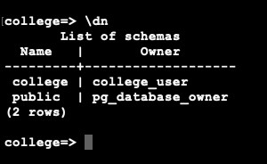
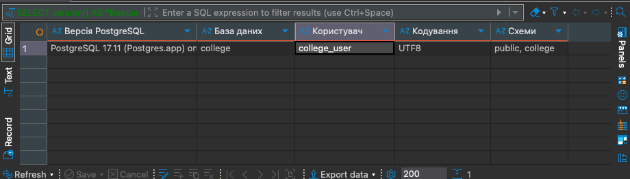
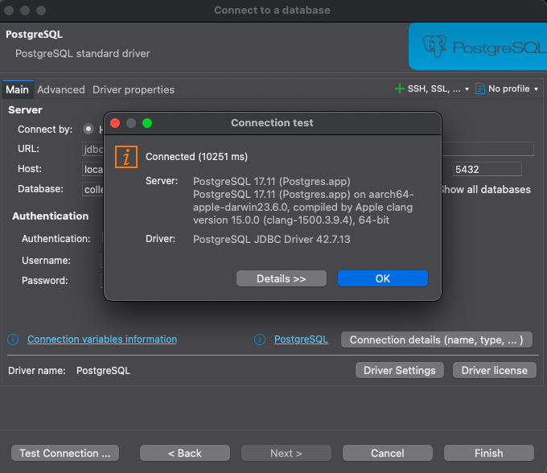
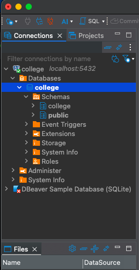
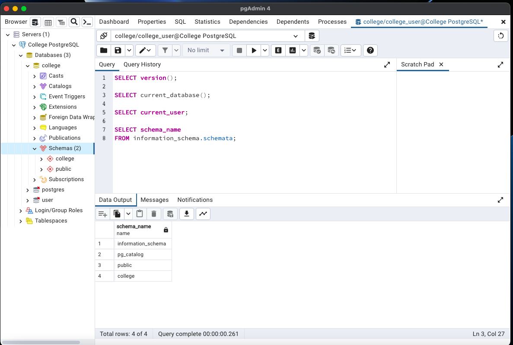
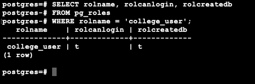
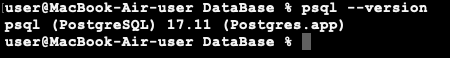
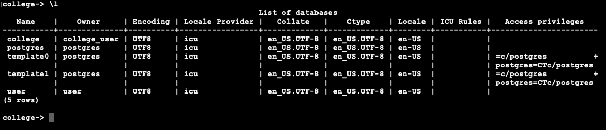
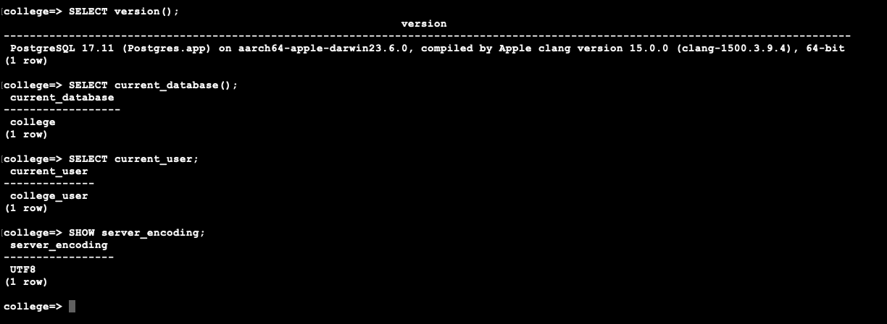
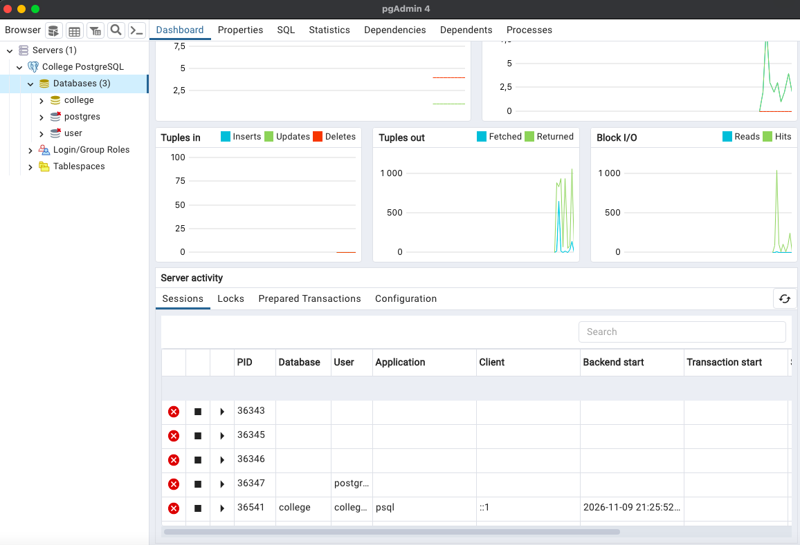

# Звіт з практичної роботи №5: Первинне налаштування СКБД і створення навчальної бази

## 1. Мета роботи

**Мета:** Встановити систему керування базами даних PostgreSQL, налаштувати підключення до сервера, створити навчальну базу даних і схему, а також перевірити роботу консольного та графічних клієнтів.

**Основні завдання:**

- Встановити PostgreSQL та визначити версію сервера.
- Налаштувати пароль суперкористувача.
- Створити роль користувача з правом створення баз даних.
- Створити навчальну базу даних `college` з кодуванням UTF8.
- Створити схему `college`.
- Перевірити підключення через консольний клієнт psql.
- Налаштувати підключення через DBeaver та pgAdmin.
- Виконати SQL-запити для перевірки роботи бази даних.

## 2. Встановлення та запуск PostgreSQL

Практичну роботу виконано на MacBook Air з операційною системою macOS Monterey 12.7.6.

Для встановлення PostgreSQL використано застосунок Postgres.app, який дозволяє запускати сервер баз даних безпосередньо на macOS.

Після встановлення було запущено PostgreSQL 17.

**Основні параметри сервера:**

- СКБД: PostgreSQL.
- Версія: 17.11.
- Адреса сервера: localhost.
- Порт: 5432.
- Статус сервера: Running.

На рисунку 1 показано запущений сервер PostgreSQL у застосунку Postgres.app.



Для перевірки встановленої версії PostgreSQL у Terminal виконано команду:

```bash
psql --version
```

**Отриманий результат:**

```text
psql (PostgreSQL) 17.11 (Postgres.app)
```

На рисунку 2 наведено результат перевірки версії PostgreSQL через Terminal.



## 3. Первинне налаштування та створення ролі користувача

Для підключення до PostgreSQL через командний рядок використано консольний клієнт psql.

Підключення виконано командою:

```bash
psql -d postgres
```

Після підключення було налаштовано пароль суперкористувача за допомогою команди:

```text
\password
```

Для роботи з навчальною базою даних створено окрему роль `college_user`.

**SQL-команда створення ролі:**

```sql
CREATE ROLE college_user WITH LOGIN CREATEDB;
```

Параметри ролі:

- `college_user` — назва ролі.
- `LOGIN` — дозвіл на підключення до сервера.
- `CREATEDB` — право створювати бази даних.

Для нової ролі встановлено пароль за допомогою команди:

```text
\password college_user
```

Для перевірки прав користувача виконано SQL-запит:

```sql
SELECT rolname, rolcanlogin, rolcreatedb
FROM pg_roles
WHERE rolname = 'college_user';
```

**Отриманий результат:**

| rolname | rolcanlogin | rolcreatedb |
|---|---|---|
| college_user | t | t |

Значення `t` означає, що відповідне право надано.

Отже, роль `college_user` успішно створено. Вона має право підключатися до PostgreSQL та створювати нові бази даних.


## 4. Створення навчальної бази даних college

Для створення навчальної бази даних виконано підключення під роллю `college_user`.

Команда підключення:

```bash
psql -h localhost -U college_user -d postgres
```

Після підключення виконано SQL-команду:

```sql
CREATE DATABASE college
WITH ENCODING 'UTF8'
TEMPLATE template0;
```

**Результат виконання:**

```text
CREATE DATABASE
```

У результаті створено базу даних із такими параметрами:

| Параметр | Значення |
|---|---|
| Назва бази даних | college |
| Власник | college_user |
| Кодування | UTF8 |
| Сервер | localhost |
| Порт | 5432 |

Для перегляду списку баз даних використано команду:

```text
\l
```

У списку відображається створена база даних `college`, власником якої є `college_user`.

Також підтверджено, що база даних використовує кодування UTF8.



## 5. Підключення до бази даних через psql

Для підключення до створеної бази даних виконано команду:

```text
\c college
```

Після успішного підключення виконано три обов'язкові SQL-запити:

```sql
SELECT version();

SELECT current_database();

SELECT current_user;
```

**Отримані результати:**

| SQL-запит | Результат |
|---|---|
| SELECT version(); | PostgreSQL 17.11 |
| SELECT current_database(); | college |
| SELECT current_user; | college_user |

Додатково перевірено кодування бази даних:

```sql
SHOW server_encoding;
```

**Результат:**

```text
UTF8
```

Отримані результати підтверджують правильність налаштування сервера, користувача та навчальної бази даних.

Кодування UTF8 забезпечує підтримку українського тексту.



## 6. Створення схеми college

Для логічного впорядкування об'єктів у базі даних створено окрему схему `college`.

**SQL-команда:**

```sql
CREATE SCHEMA college;
```

**Результат виконання:**

```text
CREATE SCHEMA
```

Для перевірки наявності схеми виконано запит:

```sql
SELECT schema_name
FROM information_schema.schemata;
```

Додатково використано команду:

```text
\dn
```

**Отриманий результат:**

| Name | Owner |
|---|---|
| college | college_user |
| public | pg_database_owner |

У результаті підтверджено, що схема `college` успішно створена та належить користувачу `college_user`.



## 7. Встановлення та підключення DBeaver

Для графічного адміністрування PostgreSQL встановлено DBeaver Community 26.2.4.

Після запуску DBeaver створено нове підключення до PostgreSQL.

**Параметри підключення:**

| Параметр | Значення |
|---|---|
| Тип СКБД | PostgreSQL |
| Host | localhost |
| Port | 5432 |
| Database | college |
| Username | college_user |
| Password | Встановлений пароль |

Для перевірки правильності налаштування використано кнопку `Test Connection`.

У результаті отримано повідомлення:

```text
Connected
```

Також DBeaver визначив версію сервера PostgreSQL 17.11.

Це підтверджує, що графічний клієнт успішно підключається до PostgreSQL.



Після підключення у лівій частині DBeaver відкрито структуру бази даних.

У списку об'єктів відображаються:

- База даних `college`.
- Схема `college`.
- Схема `public`.

Це підтверджує правильність створення бази даних та її структури.



## 8. Виконання SQL-запитів у DBeaver

Для перевірки роботи бази даних у DBeaver відкрито SQL Editor.

Виконано SQL-команди:

```sql
SELECT version();

SELECT current_database();

SELECT current_user;

SELECT schema_name
FROM information_schema.schemata;
```

Для одночасного відображення основних параметрів створено додатковий SQL-запит:

```sql
SELECT
    version() AS "Версія PostgreSQL",
    current_database() AS "База даних",
    current_user AS "Користувач",
    current_setting('server_encoding') AS "Кодування",
    (
        SELECT string_agg(schema_name, ', ')
        FROM information_schema.schemata
        WHERE schema_name IN ('college', 'public')
    ) AS "Схеми";
```

**Отримані результати:**

| Параметр | Значення |
|---|---|
| Версія PostgreSQL | 17.11 |
| База даних | college |
| Користувач | college_user |
| Кодування | UTF8 |
| Схеми | public, college |

Таким чином, за допомогою DBeaver підтверджено правильність налаштування PostgreSQL.



## 9. Підключення через pgAdmin 4

Для додаткової перевірки роботи PostgreSQL встановлено графічний клієнт pgAdmin 4.

У програмі створено підключення з назвою `College PostgreSQL`.

**Параметри підключення:**

- Host: localhost.
- Port: 5432.
- Database: college.
- Username: college_user.
- Password: встановлений пароль.

Після успішного підключення у списку серверів відображається `College PostgreSQL`.

У розділі Databases відображається навчальна база даних `college`.

На панелі керування pgAdmin також доступна інформація про активність сервера та поточні підключення.



## 10. Виконання SQL-запитів у pgAdmin

Для виконання SQL-команд використано інструмент Query Tool.

У редакторі SQL виконано такі запити:

```sql
SELECT version();

SELECT current_database();

SELECT current_user;

SELECT schema_name
FROM information_schema.schemata;
```

За допомогою цих запитів перевірено:

- Версію сервера PostgreSQL.
- Назву поточної бази даних.
- Поточного користувача.
- Список доступних схем.

У результаті перевірки списку схем отримано:

| schema_name |
|---|
| information_schema |
| pg_catalog |
| public |
| college |

У лівій частині pgAdmin також відображається схема `college` у базі даних `college`.

Це підтверджує правильність створення схеми та успішне підключення pgAdmin до PostgreSQL.



## 11. Підсумкові налаштування системи

У результаті виконання практичної роботи отримано такі налаштування:

| Параметр | Значення |
|---|---|
| Операційна система | macOS Monterey 12.7.6 |
| СКБД | PostgreSQL |
| Версія сервера | 17.11 |
| Спосіб встановлення | Postgres.app |
| Адреса сервера | localhost |
| Порт | 5432 |
| Роль користувача | college_user |
| Права ролі | LOGIN, CREATEDB |
| База даних | college |
| Власник бази | college_user |
| Кодування | UTF8 |
| Схема | college |
| Консольний клієнт | psql 17.11 |
| Графічний клієнт №1 | DBeaver Community 26.2.4 |
| Графічний клієнт №2 | pgAdmin 4 |

## 12. Відповіді на питання для захисту

**1. Чим роль відрізняється від користувача?**

У PostgreSQL роль є універсальним механізмом керування правами доступу. Вона може використовуватися для надання дозволів на виконання певних операцій.

Користувач — це роль, яка має право LOGIN та може підключатися до сервера баз даних.

**2. Що таке схема і навіщо її створювати?**

Схема — це логічний простір імен усередині бази даних, який містить таблиці, представлення, функції та інші об'єкти.

Схеми використовуються для впорядкування структури бази даних, уникнення конфліктів назв і керування правами доступу.

**3. Як підключитися до бази через командний рядок?**

Для підключення до PostgreSQL через командний рядок використовується консольний клієнт psql.

Приклад команди:

```bash
psql -h localhost -U college_user -d college
```

Після виконання команди відкривається середовище для роботи з базою даних `college`.

**4. Яке кодування потрібне для роботи з українським текстом?**

Для коректного зберігання та обробки українського тексту використовується кодування UTF8.

Воно підтримує українські символи, латиницю та інші символи Unicode.

## 13. Висновок

У ході виконання практичної роботи №5 було встановлено та налаштовано систему керування базами даних PostgreSQL 17.11 на операційній системі macOS Monterey.

Було налаштовано підключення до сервера через консольний клієнт psql, створено роль користувача `college_user` з правом створення баз даних, а також навчальну базу даних `college` з кодуванням UTF8.

У створеній базі даних організовано схему `college` та перевірено її наявність за допомогою SQL-запитів.

Додатково встановлено та налаштовано графічні клієнти DBeaver і pgAdmin, через які виконано підключення до PostgreSQL та перевірено результати створення бази даних і схеми.

Під час виконання роботи отримано практичні навички встановлення СКБД, створення користувачів, налаштування прав доступу, створення баз даних і схем та виконання SQL-команд.

**Мету практичної роботи досягнуто.**

